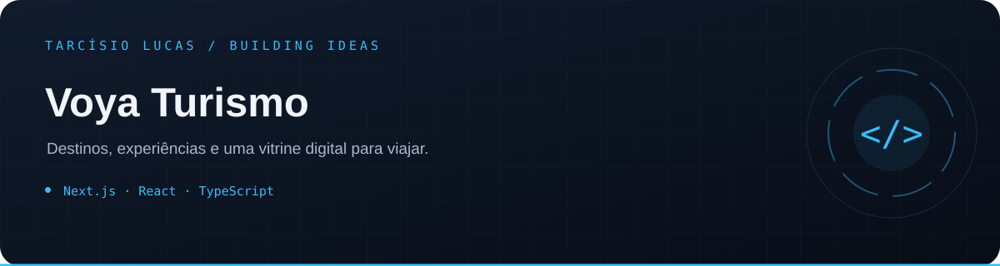

<p align="center"></p>

<p align="center"><a href="https://github.com/T-Lucas43">Perfil</a> · <a href="https://github.com/T-Lucas43?tab=repositories">Mais projetos</a> · <a href="https://www.linkedin.com/in/tarcisio-lucas-io">LinkedIn</a></p>

---

# Voya Turismo

Plataforma completa para divulgação e gestão de pacotes turísticos da Voya Turismo. O projeto reúne site público responsivo, catálogo pesquisável, páginas de detalhes, captação de leads e um painel administrativo protegido.

## Principais recursos

- Site público com vídeo Full HD no hero, animações com Motion e identidade visual da marca.
- Catálogo com busca e filtros por destino, data, categoria e preço.
- Detalhes do pacote com galeria, roteiro, inclusos, condições, disponibilidade e WhatsApp.
- Painel ADM exclusivo com dashboard, pacotes, categorias, destinos, depoimentos, perguntas, galeria, leads, usuários, configurações, histórico e arquivados.
- CRUD de pacotes com rascunho, publicação, inativação, arquivamento, duplicação e exclusão permanente confirmada.
- Upload simultâneo de múltiplas imagens e vídeos; imagens são convertidas para WebP e recebem miniaturas.
- Seleção de imagem de capa e vídeo de prévia no hover dos cards.
- Autenticação com Argon2id, sessão persistida, cookies seguros, CSRF e bloqueio temporário após tentativas inválidas.
- MySQL 8.4 e Prisma 7, com migrations, seed idempotente e histórico de auditoria.
- SEO técnico com metadata, Open Graph, sitemap, robots e manifest.
- Modo `FRONTEND_ONLY=1` para publicar na Vercel somente a vitrine pública, sem ADM, APIs ou uploads.

## Stack

- Next.js 16.3.3, React 19 e TypeScript
- CSS responsivo e Motion
- Prisma 7 com adapter MariaDB/MySQL
- React Hook Form e Zod
- Sharp para conversão e otimização de imagens
- Vitest, Testing Library e ESLint

## Execução local

Requisitos: Node.js 20 ou superior, npm e MySQL 8. O Docker é opcional.

1. Instale as dependências:

   ```bash
   npm ci
   ```

2. Copie `.env.example` para `.env` e troque todas as senhas de exemplo. `SESSION_SECRET` deve ter no mínimo 32 caracteres.

3. Inicie o MySQL com Docker:

   ```bash
   docker compose up -d mysql
   ```

4. Gere o cliente, aplique as migrations e crie os dados iniciais:

   ```bash
   npm run db:generate
   npm run db:deploy
   npm run db:seed
   ```

5. Inicie a aplicação acessível na rede local:

   ```bash
   npm run dev -- --hostname 0.0.0.0
   ```

Abra [http://localhost:3000](http://localhost:3000). O acesso administrativo fica em [http://localhost:3000/acesso-administrativo](http://localhost:3000/acesso-administrativo).

Se `ADMIN_INITIAL_PASSWORD` não estiver definido, o seed gera uma senha aleatória em `storage/dev-admin-credentials.txt`. Esse arquivo é ignorado pelo Git. Executar o seed novamente redefine a senha do usuário inicial.

## Validação

```bash
npm run lint
npm run typecheck
npm test
npm run build
```

O layout foi preparado para desktop, notebook, tablet e celulares, incluindo 1440×900, 1280×720, 768×1024, 390×844 e 360×800.

## Produção

- Frontend público na Vercel: configure `FRONTEND_ONLY=1` durante build e execução. Nesse modo, o formulário de contato abre o WhatsApp com a mensagem pronta.
- Sistema completo: use uma hospedagem Node.js com MySQL e armazenamento persistente para `storage/uploads`.
- Nunca envie `.env`, credenciais, dados do MySQL ou arquivos de upload para o repositório.

Consulte:

- [Arquitetura](docs/ARCHITECTURE.md)
- [Banco de dados](docs/DATABASE.md)
- [Guia do painel ADM](docs/ADMIN-GUIDE.md)
- [Deploy completo na Hostinger](docs/HOSTINGER-DEPLOY.md)
- [Segurança](docs/SECURITY.md)
